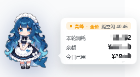
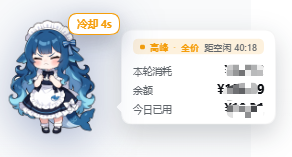
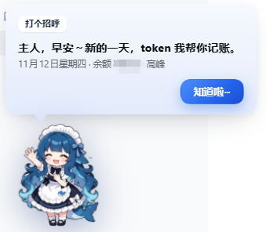
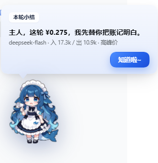

<div align="center">


# 🐳 dsh-ds-whale

**A whale balance & usage widget for DeepSeek** · DSH Web UI plugin

[简体中文](README.md) · **English**

[](CHANGELOG.md)
[](LICENSE)
[](https://github.com/Iceseas)

</div>

---

A little whale docked in the bottom-right corner: balance, today's official spend, per-turn cost and the peak/off-peak countdown — all narrated in character.

Install it into your DSH profile, reload once, and she shows up in the bottom-right corner. She greets you by nickname on startup; a left click refreshes the balance (6s cooldown by default); the right-click menu has balance details, today's weather and the settings page. Balance comes from the DSH credential `DEEPSEEK_API_KEY` (or your DSH DeepSeek sign-in), today's spend is pulled straight from the official usage API (the same numbers as `platform.deepseek.com/usage`), every turn's cost is narrated in a cute voice, and she switches between six hand-drawn expressions. Weather is fetched directly from Open-Meteo by the host process — **zero tokens**, never through a model. Everything is stored locally in `$DSH_HOME/.dsh-ds-whale.json`. The UI is available in **中文 / English**, auto-selected from your system locale.

## ✨ What it does

| | Feature | Details |
| --- | --- | --- |
| 💰 | **Balance** | Available balance (total / topped-up / granted), auto-refreshed every 60s by default. **Left click refreshes immediately** (6s cooldown by default, so mashing never hammers the API) — while refreshing you get a glow, a spinning progress ring and a "refreshing…" badge. Failures caused by the credential service not being ready right after host startup retry with backoff (4s→60s, up to 8 attempts) |
| 📊 | **Today's spend (official)** | Calls DeepSeek's usage endpoints `/api/v0/usage/by_api_key/{amount,cost}` directly, so money / requests / tokens match `platform.deepseek.com/usage` **exactly**. If the endpoint is unreachable it falls back to the balance-delta reading and labels that in the UI |
| 🗣️ | **Narrated turns** | After every turn she says, in character, how much that turn cost (5 tiers by amount), with model and input/output tokens in the sub-line. **Only closes on "got it~"** — never auto-dismisses |
| 🎭 | **Six expressions** | calm / pouting (on click) / blushing (while talking) / panicking (balance warning) / **waving hello (startup greeting)** / **chin on hand (weather)** |
| 🖱️ | **Left click refresh · right-click menu** | Right click (no hit shake) opens: refresh now / balance details / top up / today's weather / open whale settings. "Top up" opens the official top-up page in one click (prefers the `topUpUrl` from DSH's account service, falls back to `platform.deepseek.com/top_up`) — no need to open a panel first. Menu items have proper hover highlight and transitions |
| 🌤️ | **Today's weather** | "Today's weather" in the right-click menu: **zero tokens**. Current temperature, today's range, rain probability, the next three hours, plus a line on whether to grab an umbrella or hydrate. First use lets you **type the city right in the bubble** (the input sits next to the whale; save and the weather shows up immediately, no trip to the settings page). City → lat/lon has three fallbacks (built-in city table → photon → Open-Meteo), and it distinguishes "city not found" from "network unreachable" |
| 👋 | **Startup greeting** | Every time DSH opens she greets you by your nickname in the same cute voice (six tiers by time of day), with the waving pose and a chime |
| 💬 | **Persistent bubble** | A small vertical bubble next to the avatar: a **peak/off-peak status strip** on top (dot + peak/idle + full price/50% off + countdown to the next switch), and the 1–3 metrics you picked below (balance / today / local estimate / this turn / peak countdown) |
| ⏰ | **Peak pricing** | Weekdays 09:00–12:00 and 14:00–18:00 are peak (full price); all other hours and weekends are idle (50% off). The bubble has the status strip, the details panel has a **24-hour price band** with a now-cursor, the current window and the next window's name; weekend countdowns are shown as "d:h" |
| 🚨 | **Balance / budget alerts** | Below the warning line or over today's budget she switches to the panicking face and narrates it, with "top up" / "see usage" / "got it" buttons |
| 📒 | **Usage ledger** | Today / last 7 days / all time, model share, search by model or date; clear today, clear all, reset baseline |
| ⚙️ | **Settings page** | A dedicated "小鲸鱼 / Whale" page in **DSH Settings → left nav** (right below 喵记忆), plus the host-generated form at **DSH Settings → Plugins → dsh-ds-whale**. "Open whale settings" in the right-click menu jumps straight to it |
| 🖱️ | **Feel** | Drag to move with position memory (stores "which edge + how far from that edge", so resizing the window keeps the edge, not the distance), edge snapping judged by the **page midline**, a size slider. The whale can be dragged to the very top of the window — narration bubbles and the details panel then flip below it (based on measured height), and the small persistent bubble follows vertically centered, so nothing gets clipped by the window edge |

<div align="center">


</div>

## 👋 Three new gestures

| When | Pose | Sample line |
| --- | --- | --- |
| DSH opens | waving hello | "小蓝，早上好呀！余额我盯好了，随时可以开工。" — "Good morning, Xiaolan! Balance is watched, we can start whenever." |
| Click "Today's weather" | chin on hand | "Beijing · 7°C clear" / today 4–16°C · mostly clear · 0% rain |
| Click weather before setting a city | chin on hand | "Tell me which city first~" → an input appears right in the bubble; save and the result shows immediately |

<div align="center">


<br />


</div>

## 🚀 Install

Prerequisites: DSH desktop app or `dsh web`, Node ≥ 20.

**Option 1: install from GitHub (recommended)**

```bash
# install the whole repo into the current profile's plugin directory
dsh plugin add github:Iceseas/dsh-ds-whale
```

Restart DSH (or reload the plugin) and the whale appears in the bottom-right corner. If your DSH build has no `plugin add`, do a one-off local install:

```bash
git clone https://github.com/Iceseas/dsh-ds-whale.git
# then in DSH run plugin_manager action=install_bundle with target set to that directory's absolute path
```

**Option 2: drop it in manually**

1. Copy the repo to `<DSH_PROFILE_DIR>/node_modules/dsh-ds-whale` (`DSH_PROFILE_DIR` is usually `~/.dsh/profiles/desktop`);
2. Add `"dsh-ds-whale"` to `dsh.profile.bundles` in that profile's `package.json`;
3. Restart DSH.

**What it needs to be useful right away**: DeepSeek credentials configured in DSH (`DEEPSEEK_API_KEY`) **or** a signed-in DeepSeek account. Without either, the widget still appears — the balance row just says credentials are needed.

## ⬆️ Update

To see the current version: whale panel → Settings; the bottom line shows `版本 vX.Y.Z` and "view new version" (goes to the Releases list). For the latest version see [Releases](https://github.com/Iceseas/dsh-ds-whale/releases) (everything in 0.x ships as a Pre-release, so the repo's Releases card hides it and `/releases/latest` doesn't point at it — **display-only, install and update are unaffected**).

**Installed without a version pin** (`github:Iceseas/dsh-ds-whale`) — tracks the default branch, one command:

```bash
dsh plugin update dsh-ds-whale
```

**Pinned to a tag** (`.../dsh-ds-whale#v0.9.8`) — `update` won't cross versions, switch the tag explicitly:

```bash
# replace vX.Y.Z with the target tag (pick the latest one from Releases)
dsh plugin add github:Iceseas/dsh-ds-whale#vX.Y.Z
```

**Installed from a zip / by hand**: download the new `dsh-ds-whale-x.y.z.zip`, overwrite `<DSH_PROFILE_DIR>/node_modules/dsh-ds-whale/` wholesale, restart.

Either way, **restart DSH** afterwards — the plugin has host-side code (`lib/index.js` routes and state) and hot reload only swaps the front end.

> Multi-profile setups (`desktop` + `web`) need `--profile`, e.g. `dsh plugin update dsh-ds-whale --profile web`.

## 🔐 Data & privacy

- The only data file: `$DSH_HOME/.dsh-ds-whale.json` (Windows default `C:\Users\<you>\.dsh\.dsh-ds-whale.json`), **local only**.
- It stores: balance observations, official usage cache, daily totals, per-turn amounts. **No conversation content**, nothing uploaded.
- Only three outbound requests, all using credentials already on your machine (the third is credential-free):
  1. `GET https://api.deepseek.com/user/balance` (Bearer `DEEPSEEK_API_KEY`)
  2. Official usage `GET https://platform.deepseek.com/api/v0/usage/by_api_key/{amount,cost}` (with the DSH-session `x-dsh-auth-token`)
  3. Weather (only when you click "Today's weather"): city name → lat/lon, then the forecast. **No credentials, no token, nothing beyond the city you typed**; results are cached in the host process for 10 minutes. Geocoding has three fallbacks: built-in coordinate table for common cities (a hit means no network at all) → `photon.komoot.io` → `geocoding-api.open-meteo.com`; forecasts only go to `api.open-meteo.com`
- No hard-coded secrets anywhere; the repo carries no `.env`, credentials or personal paths.
- "Clear today / clear all / reset baseline" at the bottom of the ledger page wipes the books whenever you want.

## ⚙️ Settings

| Field | Details |
| --- | --- |
| UI language `language` | `auto` follows the system locale / `zh` Chinese / `en` English; in English both the UI and the narration are fully English |
| Nickname `nickname` | How she addresses you in narration (up to 16 chars; leave empty to skip names) |
| Size `scale` | 0.6–2× |
| Bubble metrics `miniFields` | `balance` / `today` / `estimate` / `turn` / `peak`, up to 3 |
| Per-turn narration `turnPop` | Turn it off and no narration popup appears |
| Warning line `warnBelow` | Below this value she switches to the panicking face; 0 = off |
| Daily budget `dailyBudget` | Alert once when exceeded; 0 = unlimited |
| Refresh interval `refreshMs` | Balance auto-refresh period (15s–1h) |
| Chime `soundOn` / `soundVolume` | End-of-turn chime and volume |
| Midline snap `snap` | Snap to the nearest side after dragging (judged by the page midline) |
| Peak hours `showPeak` | Whether the persistent bubble shows the status strip (peak/idle, full/50%, countdown to the next switch); off leaves only your chosen numbers |
| Click cooldown `clickCooldownMs` | Minimum interval between left-click refreshes (2000–120000ms, default 6000) so rapid clicking can't hammer the balance API |
| Startup greeting `greetOnStart` | Whether to greet you by nickname every time DSH opens |
| Weather city `weatherCity` | City used for weather (e.g. `Shanghai` / `Tokyo`). **Required**: without it, "Today's weather" asks right inside the bubble and shows the result once saved. In the settings page this field also saves as you type (800ms debounce, no blur needed) |
| Cache accounting `cacheInInput` | Whether `inputTokens` already includes cache hits; DeepSeek does not, so keep this off |

## 🧮 Pricing & math

CNY per million tokens, formatted `[idle, peak]`:

| Model family | Cache hit | Cache miss input | Output |
| --- | --- | --- | --- |
| `deepseek-flash` (incl. the v4-flash series) | 0.02 / 0.04 | 1 / 2 | 4 / 8 |
| `deepseek-v4-pro` (incl. pro / reasoner / r1) | 0.15 / 0.30 | 4.5 / 9.0 | 13.5 / 27.0 |

`cost = (cache hits × hit price + cache-miss input × input price + output × output price) / 1e6`

In DeepSeek's usage, `totalTokens = inputTokens + outputTokens + cacheReadTokens` — i.e. `inputTokens` **excludes** cache hits, so "cache-miss input" can use `inputTokens` directly. Only turn on `cacheInInput` when some provider folds cache hits into `inputTokens`.

**How the three readings relate**: official usage (authoritative, the main number) → balance-delta observation (corroborating) → local token estimate (cross-check). The panel renders their difference as "deviation", which is how you spot price-table drift.

## 🧩 Routes

Prefix `/api/dsh-ds-whale`, same-origin `POST` (reachable only from the local browser):

| Route | Purpose |
| --- | --- |
| `/state` | Balance + today (incl. official usage) + peak hours + settings + recent records (stale data is refetched automatically) |
| `/refresh` | Force-refresh balance and official usage |
| `/weather` | Today's weather (`{force?, city?}`): zero tokens. Returns `{ok:false, error:"need-city"}` when no city is configured, `geocode-failed` when the city isn't found, `geocode-offline` on network failure (the two have different messages) |
| `/settings` | Write settings: `{"patch":{...}}` changes runtime state, `{"config":{...}}` writes into the profile's `cordis.patch.yml` |
| `/ledger` | `clear-today` / `clear-all` / `ack-adjust` / `rebaseline` |
| `/history` | Search history by model name or date |
| `/client-hello` | Front-end self-report (build / current mood) for troubleshooting |
| `GET /avatar.png` | Avatar PNG; supports `?size=128` and `&mood=angry\|blush\|panic\|greet\|think`; ETag enabled |

## 🛠️ Development

```
dsh-ds-whale/
├── lib/index.js      # Host half: balance, official usage, ledger, HTTP routes, config schema
├── lib/client.js     # Client half: dock UI, mood animation, narration, settings page components
├── assets/           # six poses + small sizes
├── locale/           # meta.title / meta.description
├── scripts/gen-avatars.mjs  # batch-generate the poses via local Agnes (six moods)
├── scripts/cut-bg.ps1       # white → transparent (4-edge flood fill + edge feathering)
├── scripts/build-avatar.ps1 # trim to bbox + downscale to 512/128/64
├── scripts/finalize-avatars.ps1 # chains the two steps above
├── cordis.patch.yml  # plugin line declaration
└── package.json
```

- Editing `lib/client.js`: DSH's client-hmr hot-reloads it (do one Ctrl+Shift+R hard refresh if needed, so an old module instance doesn't sit under the new one).
- Editing `lib/index.js`: reload the host half (toggle the plugin off/on in the plugin manager).
- Poses: `node scripts/gen-avatars.mjs` (requires DSH running + `dsh-agnes-studio` installed with `AGNES_API_KEY` configured) generates six images into `avatar-out/` from `CHARACTER` + `POSES`; then `& scripts\finalize-avatars.ps1 -SrcDir avatar-out -OutDir avatar-out\final -Pad 0.02` removes the white background, trims to the bbox and exports 512/128/64; finally overwrite `assets/`. File prefixes are fixed as `whale` / `whale-angry` / `whale-blush` / `whale-panic` / `whale-greet` / `whale-think`; the host serves them straight from `MOOD_FILES` (`mood=greet` / `mood=think`). To use your own art, drop same-named files into `~/.dsh/dsh-ds-whale-assets/` — no repo changes needed.

## 📄 License

[MIT](LICENSE) © 2026 Iceseas

> Unofficial project. DeepSeek and DeepSeek Harness names and trademarks belong to their respective owners.
